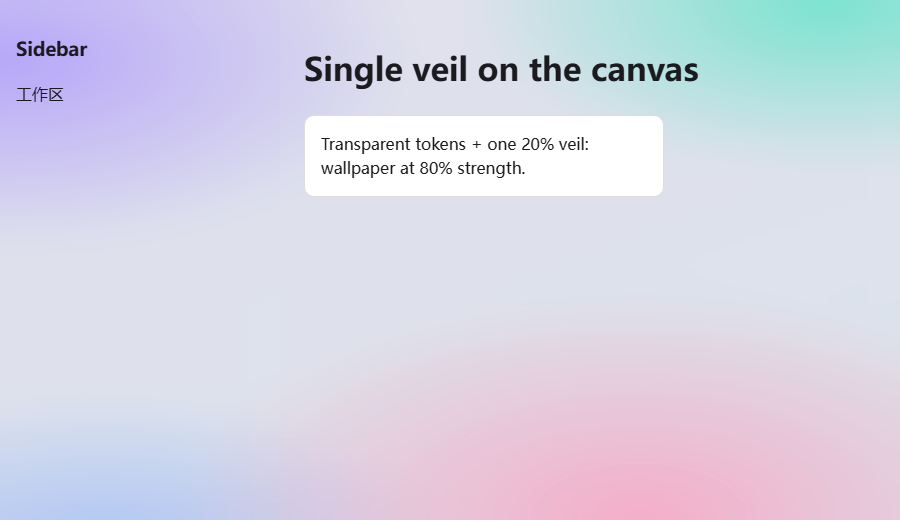

# dsh-lively

Live wallpaper layer for the **DeepSeek Harness Web GUI**: an animated wallpaper
behind the interface — procedural presets, images, GIF or video — with a small
settings page to pick the look.



## Features

- **Five procedural presets** — Aurora, Starfield, Lava, Mesh, Neon grid. Each
  has a dark variant for the dark palette and a bright variant for the light
  palette, so a light theme never ends up with a grey wash.
- **Custom wallpaper** — image, GIF, WebP, AVIF, MP4 or WebM, by URL or uploaded
  from disk. Uploads live under `$DSH_HOME/dsh-lively-media/` and are served by
  the plugin's own route, so they survive a reload and a restart.
- **Controls** — wallpaper strength (how much wallpaper shows through), dim,
  video softness, animation speed, pause when the window is hidden.
- **Theme aware** — the veil is keyed on `body[data-ds-dark-theme]`; the
  bright/dark preset variants are keyed on `html[data-dsh-lively-tone]`.

## Install

```sh
git clone https://github.com/<you>/dsh-lively.git
dsh plugin --profile desktop add ./dsh-lively
```

Then restart DSH (the sidebar's restart button, if installed) and open
**Settings → Live wallpaper**.

## How it works

- The wallpaper is the **root element's background** (`html`), i.e. the canvas —
  the one surface always below every column. Only video needs a real element, so
  a fixed `z-index:-1` layer exists solely for that case.
- The shell paints `--dsw-alias-bg-base` on the frame *and* on the centre
  column, and alphas multiply. The token is therefore fully **transparent**, and
  the single theme-coloured veil is drawn once on the canvas pseudo-elements
  (`html::before` for the veil, `html::after` for the dim).
- No `backdrop-filter` on the shell columns: it would make them the containing
  block for fixed-position descendants, and the sidebar's fold toggle is
  `position: fixed` — frosting the column drags that button onto the brand mark.
- Settings persist twice: `localStorage` (instant) and
  `$DSH_HOME/dsh-lively-state.json` via `/dsh-lively/state`, because the Desktop
  app's loopback port changes on every launch.

## Limitations

- A video wallpaper needs a real `<video>` element; CSS alone cannot play video.
- The softness control applies to video only — CSS cannot blur the root
  background, and blurring the columns breaks fixed-position shell chrome.
- The frame-transparency rule targets `[class$='_frame']`, which follows the
  shell's CSS-module naming.

## License

MIT
